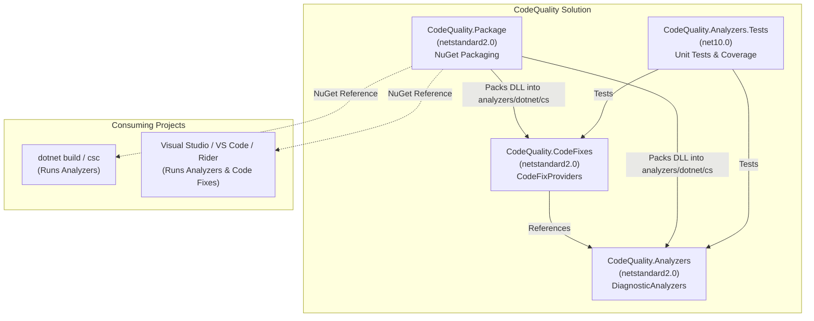
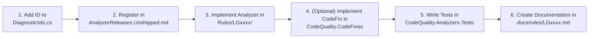

# CodeQuality Architecture & Developer Guide

`CodeQuality` is a Roslyn analyzer and code fix library designed to enforce clean code and design standards across .NET codebases.

## Architecture Overview



### Project Responsibilities

| Project | Target Framework | Purpose |
| --- | --- | --- |
| `CodeQuality.Analyzers` | `netstandard2.0` | Contains all `DiagnosticAnalyzer` implementations and rule descriptors. Runs inside both the command-line C# compiler (`csc`) and IDEs. |
| `CodeQuality.CodeFixes` | `netstandard2.0` | Contains all `CodeFixProvider` implementations. Depends on `Microsoft.CodeAnalysis.CSharp.Workspaces` and provides refactorings / quick fixes in IDEs. |
| `CodeQuality.Package` | `netstandard2.0` | Non-deployable project configured to pack both analyzer and code fix binaries into the `analyzers/dotnet/cs/` folder of the `CodeQuality.nupkg` package. |
| `CodeQuality.Analyzers.Tests` | `net10.0` | Comprehensive unit tests exercising analyzer diagnostics, code transformations, and batch fixers with 100% line and branch test coverage. |

## NuGet Package Structure

Roslyn analyzers are development-time dependencies and are packaged directly into the language-specific analyzer folder:

```
LngCodeQuality.<version>.nupkg
├── analyzers/
│   └── dotnet/
│       └── cs/
│           ├── CodeQuality.Analyzers.dll
│           └── CodeQuality.CodeFixes.dll
├── README.md
└── LngCodeQuality.nuspec
```

When a consuming project adds `<PackageReference Include="LngCodeQuality" Version="..." />`, MSBuild automatically passes the analyzers to the compiler via `-analyzer` without copying them into the consumer's runtime publish output.

## Adding a New Analyzer Rule

Follow this workflow to add a new analyzer rule:



### Step 1: Assign a Rule ID and Category
1. Define the rule ID in `src/CodeQuality.Analyzers/DiagnosticIds.cs` (e.g., `LG0003`).
2. Add the category in `src/CodeQuality.Analyzers/DiagnosticCategories.cs` if not already present.

### Step 2: Register in Release Tracking
Add an entry in `src/CodeQuality.Analyzers/AnalyzerReleases.Unshipped.md`:
```markdown
### New Rules

Rule ID | Category | Severity | Notes
--------|----------|----------|--------------------
LG0003  | Design   | Warning  | Short description
```

### Step 3: Implement DiagnosticAnalyzer
Create `src/CodeQuality.Analyzers/Rules/LGxxxx/<RuleName>Analyzer.cs`:
- Inherit from `DiagnosticAnalyzer`.
- Mark with `[DiagnosticAnalyzer(LanguageNames.CSharp)]`.
- Enable concurrent execution (`context.EnableConcurrentExecution()`) and configure generated code analysis (`context.ConfigureGeneratedCodeAnalysis(GeneratedCodeAnalysisFlags.None)`).
- Register syntax or semantic model actions.

### Step 4: Implement CodeFixProvider (Optional)
If a quick-fix can resolve the diagnostic automatically:
- Create `src/CodeQuality.CodeFixes/Rules/LGxxxx/<RuleName>CodeFixProvider.cs`.
- Inherit from `CodeFixProvider`.
- Mark with `[ExportCodeFixProvider(LanguageNames.CSharp, Name = nameof(<RuleName>CodeFixProvider))]` and `[Shared]`.
- Return `WellKnownFixAllProviders.BatchFixer` from `GetFixAllProvider()`.

### Step 5: Write Unit Tests
In `tests/CodeQuality.Analyzers.Tests/Rules/LGxxxx/`:
- Write tests using `CSharpAnalyzerVerifier<TAnalyzer>` and `CSharpCodeFixVerifier<TAnalyzer, TCodeFix>`.
- Use markup syntax `[|...|]` or `{|LGxxxx:...|}` for expected diagnostic locations.
- Verify both positive and negative cases, as well as fix-all batch operations.
- Ensure 100% line and branch test coverage.

### Step 6: Document the Rule
Create `docs/rules/LGxxxx.md` describing the cause, resolution, and examples.

## Building, Testing, and Packaging

```bash
# Build solution
dotnet build CodeQuality.slnx

# Run tests with code coverage collection
dotnet test CodeQuality.slnx --collect:"XPlat Code Coverage"

# Build NuGet package
dotnet pack CodeQuality.slnx -c Release
```

For instructions on versioning and publishing releases to GitHub Packages, see [docs/publishing.md](publishing.md).
