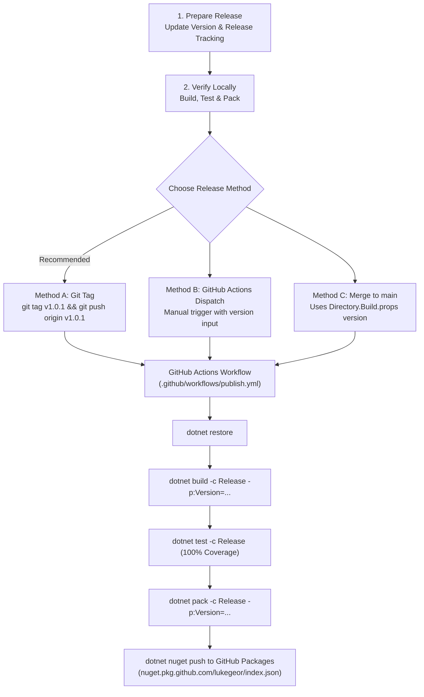

# Publishing Guide

This guide details the process for versioning, packing, and publishing new releases of the `CodeQuality` analyzer package to GitHub Packages.

## Release Process Overview



---

## 1. Release Preparation

### Step A: Update Analyzer Release Tracking
Roslyn analyzers enforce release tracking via `<EnforceExtendedAnalyzerRules>true</EnforceExtendedAnalyzerRules>`. When shipping a release containing new rules or rule updates:

1. Move shipped rules from [`src/CodeQuality.Analyzers/AnalyzerReleases.Unshipped.md`](../src/CodeQuality.Analyzers/AnalyzerReleases.Unshipped.md) to [`src/CodeQuality.Analyzers/AnalyzerReleases.Shipped.md`](../src/CodeQuality.Analyzers/AnalyzerReleases.Shipped.md) under a release header.

**Example `AnalyzerReleases.Shipped.md`**:
```markdown
; File format: Rule ID | Category | Severity | Notes

### Release 1.0.1

Rule ID | Category | Severity | Notes
--------|----------|----------|--------------------
LG0001  | Reliability | Warning  | Avoid null-forgiving operator
LG0002  | Readability | Warning  | Remove unnecessary using directive
```

**Example `AnalyzerReleases.Unshipped.md`**:
```markdown
; File format: Rule ID | Category | Severity | Notes

### New Rules

Rule ID | Category | Severity | Notes
--------|----------|----------|--------------------
```

### Step B: Update Version in `Directory.Build.props` (Optional)
Update `<Version>` in [`Directory.Build.props`](../Directory.Build.props) to reflect the new default version:

```xml
<PropertyGroup>
  <Version>1.0.1</Version>
</PropertyGroup>
```

### Step C: Verify Locally
Ensure all projects compile cleanly with zero warnings and all tests pass with 100% line and branch test coverage:

```bash
# Clean, build, test, and pack locally
dotnet clean CodeQuality.slnx
dotnet build CodeQuality.slnx -c Release
dotnet test CodeQuality.slnx -c Release --collect:"XPlat Code Coverage"
dotnet pack CodeQuality.slnx -c Release -o ./artifacts
```

Commit changes to git before triggering publishing.

---

## 2. Publishing Methods

### Method 1: Git Tag (Recommended)

Pushing a semver tag prefixed with `v` automatically triggers the GitHub Actions workflow, extracts the version number, builds, tests, packs, and publishes the package:

```bash
# 1. Create a tag matching the version
git tag v1.0.1

# 2. Push tag to GitHub
git push origin v1.0.1
```

The workflow will:
1. Detect tag `v1.0.1`.
2. Extract `1.0.1`.
3. Pass `-p:Version=1.0.1` to the build and pack commands.
4. Publish `CodeQuality.1.0.1.nupkg` to GitHub Packages.

---

### Method 2: Manual Workflow Dispatch

You can trigger publishing manually through GitHub's web interface or CLI:

#### Via GitHub CLI:
```bash
gh workflow run publish.yml -f version=1.0.1
```

#### Via GitHub Web UI:
1. Navigate to the repository's **Actions** tab on GitHub.
2. Select the **Build, Pack & Publish** workflow on the left sidebar.
3. Click **Run workflow**.
4. (Optional) Provide a custom version in the **Package version to publish** field.
5. Click the green **Run workflow** button.

---

### Method 3: Push / Merge to `main`

Pushing commits or merging a pull request into `main` automatically triggers the workflow and publishes the version defined in `Directory.Build.props`.

> [!NOTE]
> The workflow includes `--skip-duplicate`. If the package version already exists on GitHub Packages, the push step will skip it gracefully without failing the workflow.

---

### Method 4: Manual Local Publishing (Fallback / Emergency)

To manually push a package from your local machine:

1. Create a GitHub Personal Access Token (classic) with `write:packages` scope.
2. Build and pack the solution:
   ```bash
   dotnet pack CodeQuality.slnx -c Release -p:Version=1.0.1 -o ./artifacts
   ```
3. Push using `dotnet nuget push`:
   ```bash
   dotnet nuget push "./artifacts/CodeQuality.1.0.1.nupkg" \
     --source "https://nuget.pkg.github.com/lukegeor/index.json" \
     --api-key "<YOUR_GITHUB_PAT>" \
     --skip-duplicate
   ```

---

## 3. Consuming Published Packages

Projects consuming `CodeQuality` from GitHub Packages must configure NuGet authentication and register the GitHub Packages source.

### Step 1: Configure `nuget.config` in Consuming Repository

Place a `nuget.config` at the root of the consuming repository:

```xml
<?xml version="1.0" encoding="utf-8"?>
<configuration>
  <packageSources>
    <clear />
    <add key="nuget.org" value="https://api.nuget.org/v3/index.json" protocolVersion="3" />
    <add key="github" value="https://nuget.pkg.github.com/lukegeor/index.json" />
  </packageSources>
  <packageSourceMapping>
    <packageSource key="nuget.org">
      <package pattern="*" />
    </packageSource>
    <packageSource key="github">
      <package pattern="CodeQuality*" />
    </packageSource>
  </packageSourceMapping>
</configuration>
```

### Step 2: Add Package Reference

In the consuming project's `.csproj`:

```xml
<ItemGroup>
  <PackageReference Include="CodeQuality" Version="1.0.1">
    <PrivateAssets>all</PrivateAssets>
    <IncludeAssets>runtime; build; native; contentfiles; analyzers; buildtransitive</IncludeAssets>
  </PackageReference>
</ItemGroup>
```
